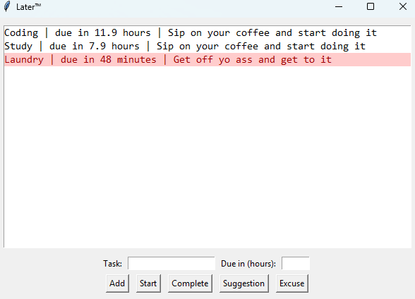

# Later™

A task manager built for professional procrastinators.

Later™ looks like a normal to-do app, but it is on your side in the worst way: press **Start** on a task and it always finds a "better time" to begin. It only stops enabling you when the deadline is under an hour away, and then it drops the act.



## Features

- **Delay Engine:** "Start" never starts anything. It pushes your planned start time later and gives you a reason ("Starting now would be rushing. Quality takes patience.").
- **Panic Index:** every task gets a progress bar and a mood, from "Relax" to "Why are you still on this app?".
- **Panic mode:** with less than an hour left, delaying is refused and the row turns red.
- **Excuse generator:** combines random pieces into a fresh excuse every time.
- **Productive procrastination suggestions:** things that feel like work but aren't.
- **Live countdown:** the list updates every second.
- **Saves automatically:** your tasks survive a restart.
- **Two front ends:** a desktop window (`gui.py`) and a terminal menu (`later.py`) sharing the same logic.

## Run it

Requires Python 3.9+ (tkinter comes with Python on Windows and macOS).

```
git clone https://github.com/YOUR-USERNAME/later.git
cd later
py gui.py        # desktop window
py later.py      # terminal version
```

On macOS/Linux, use `python3` instead of `py`.

## Build a standalone app

```
py -m pip install pyinstaller
py -m PyInstaller --onefile --windowed --name Later gui.py
```

The app is created at `dist/Later.exe`. It is not code-signed, so Windows SmartScreen may warn on first launch ("More info" then "Run anyway").

## Project structure

```
task.py       Task class: deadline, delay logic, panic level and bar
content.py    Jokes, excuses, suggestions and message helpers
storage.py    Saving and loading tasks as JSON
later.py      Terminal menu
gui.py        tkinter window
```

Tasks are saved to `.later_tasks.json` in your home folder.

## What I learned

Classes, lists and dictionaries, `datetime` math, JSON file handling, input validation, tkinter (widgets, callbacks, `after()` timers), and packaging with PyInstaller.

## Ideas for later

(Obviously.)

- Desktop notifications when a task enters panic mode
- System tray icon
- AI-generated excuses with the built-in lists as a fallback

## License

MIT, do whatever you like. Just don't ask me to finish it today.
